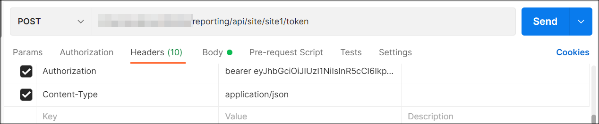
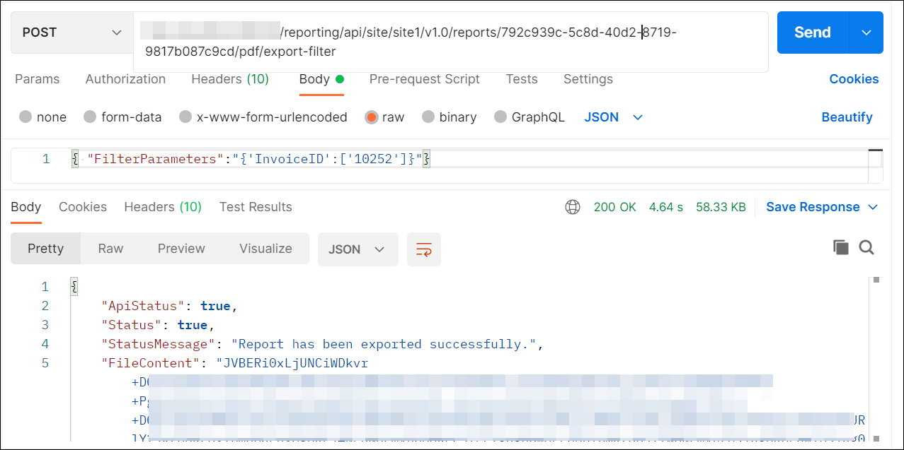

# How to export the Report with filter parameter using API from the postman

In Bold Reports® Report Server, users with read access for reports can export a report through the API with filter parameter values. You send the report details, filter parameter, and export type (Microsoft Excel, PDF, HTML, PPT, CSV, XML, or Word) in the request body.

## How do I export a filtered report from Postman?

You export a filtered Report Server report from Postman with a `POST` request that carries the filter parameter values. Follow these steps:

1. Open the `Postman` application and create a new `POST` Http request.

2. Generate the [Report Server authentication token using the API](../generate-authentication-token-for-bold-reports-server-using-api/).

3. In the request URL, provide your Report Server URL and append `reporting/api/site/{tenant-name}/v1.0/reports/export` for the <a href="https://help.boldreports.com/enterprise-reporting/rest-api-reference/v1.0/server-api-reference/#operation/Items_ExportReport" target="_blank">export report</a> API.

4. In the headers section, add `Authorization` as the key, `bearer` as the value, and include the generated token.
    

5. In the body section, choose `raw` and select `Json`.

6. Pass the report ID and export type as path parameters, and pass the filter parameter values in JSON format.

7. Click `Send`. The response is an array of bytes.
    

## Frequently asked questions

### How do I pass filter values to the export API?

Pass the report ID and export type as path parameters, and pass the filter parameter values in JSON format in the request body.

### What does the export API return?

The response is an array of bytes.

## See also

* [Export a report using the API in Postman](./../export-the-report-using-api/)
* [Export a report with the Export Report API](./../export-report-from-bold-reports-server/)
