# How to filter data based on user in a report

In Bold Reports<sup>®</sup> Report Server, you can filter and display data based on the user who runs the report. For example, you can design a report in Bold Reports<sup>®</sup> Designer that displays the sales history of the salesperson running the report. The steps below show how. First, you connect to the data and present it in a table with the table report item.

## Connecting to Data

The Bold Reports<sup>®</sup> sales history example uses sample data from a temporary table created with a SQL query in the query designer. You can also [connect to your data in the Report Designer](./../../../designer-guide/report-designer/manage-data/) from any of your server or local databases.

1. Click the `Data` icon in the configuration panel to open the `Data` configuration pane.
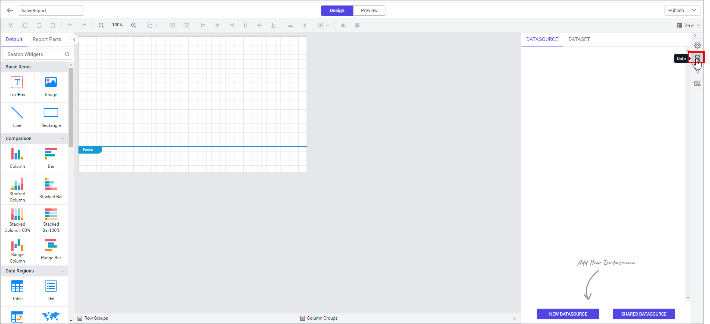
2. Click the `New Data` button in the Data panel.
3. In the connection type panel, click the data source type that you want to connect. This example uses the `SQL` connection type.
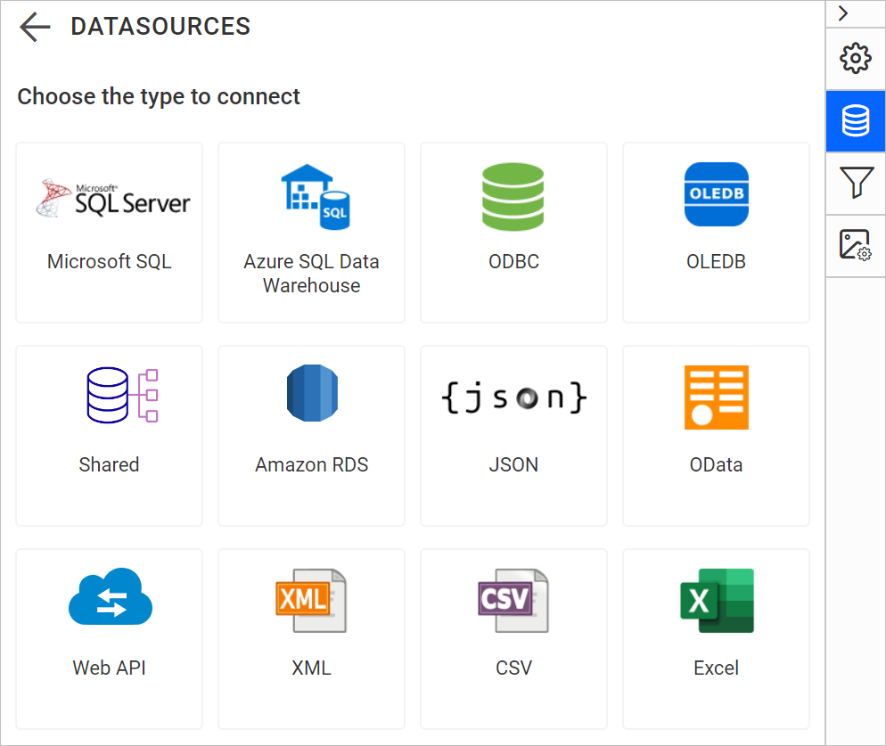
4. In the new data source configuration panel, fill in the server name and related details. Because this example creates the dataset from a temporary table, you can provide credentials and connect to any of your server or local databases.
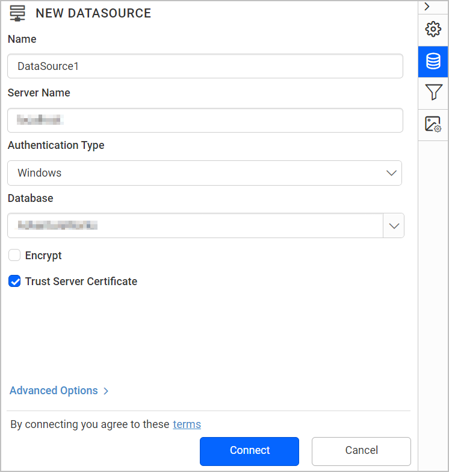
5. Click the `Connect` button. The following view appears.
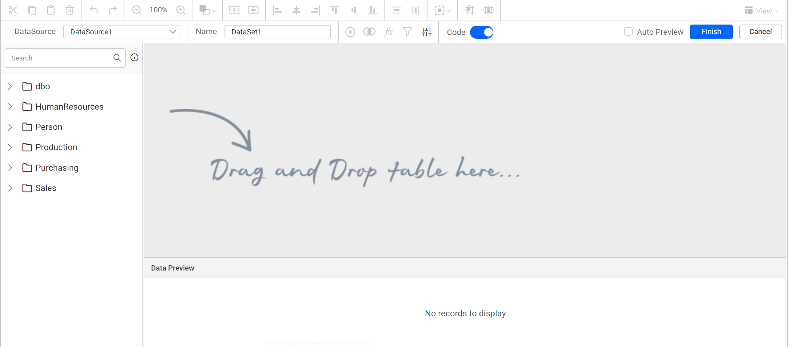
6. In the query builder, build a query with existing tables in your database or use the following query:

   ```sql
   DROP TABLE UserInfo
   CREATE TABLE UserInfo
   (
   user_id INT IDENTITY PRIMARY KEY,
   SalesPersonID VARCHAR(200) NOT NULL,
   SalesPerson VARCHAR(100) NOT NULL,
   CustomerName VARCHAR(100) NOT NULL,
   ProductName VARCHAR(100) NOT NULL,
   PurchaseDate DATETIME NOT NULL,
   ExpiryDate DATETIME NOT NULL,
   Amount Float,
   LicenseType VARCHAR(100) NOT NULL
   )
   INSERT INTO UserInfo
   VALUES ('smith@syncfusion.com','Smith', 'James', 'WEB (Essential JS 2)', '3/1/2016', '3/1/2017','23456', 'Standard'),
   ('smith@syncfusion.com','Smith', 'Jeff', 'WEB (Essential JS 1)', '9/8/2019', '9/8/2020','12323', 'Community'),
   ('smith@syncfusion.com','Smith', 'Armstrong', 'Embedded Reporting Tools', '1/12/2018', '1/12/2020','79897', 'Standard'),
   ('smith@syncfusion.com','Smith', 'Cromley', 'EnterpriseBI', '1/12/2018', '1/12/2020','45364', 'Platinum'),
   ('smith@syncfusion.com','Smith', 'Richardson', 'EnterpriseBI', '2/11/2017', '2/11/2020','21467', 'Platinum'),
   ('smith@syncfusion.com','Smith', 'Horton', 'Cloud BI', '9/11/2018', '2/11/2020','87897', 'Standard'),
   ('smith@syncfusion.com','Smith', 'Washington', 'Embedded BI', '3/8/2019', '3/8/2020','13446', 'Platinum'),
   ('smith@syncfusion.com','Smith', 'Victoria', 'WEB (Essential JS 2)', '3/8/2019', '3/8/2020','43566', 'Standard'),
   ('smith@syncfusion.com','Smith', 'Eric', 'FILE FORMAT', '3/8/2004', '8/12/2005','67899', 'Community'),
   ('smith@syncfusion.com','Smith', 'John', 'MOBILE', '8/8/2019', '8/8/2020','89800', 'Standard'),
   ('anderson@syncfusion.com','Anderson', 'Eric', 'WEB (Essential JS 2)', '1/1/2016', '1/1/2017','23456', 'Standard'),
   ('anderson@syncfusion.com','Anderson', 'James', 'WEB (Essential JS 1)', '10/8/2019', '10/8/2020','12323', 'Community'),
   ('anderson@syncfusion.com','Anderson', 'Victoria', 'Embedded Reporting Tools', '11/12/2018', '11/12/2020','79897', 'Standard'),
   ('anderson@syncfusion.com','Anderson', 'Charles', 'EnterpriseBI', '12/12/2018', '12/12/2020','45364', 'Platinum'),
   ('anderson@syncfusion.com','Anderson', 'Horton', 'EnterpriseBI', '5/11/2017', '5/11/2020','21467', 'Platinum'),
   ('anderson@syncfusion.com','Anderson', 'Richard', 'Cloud BI', '6/11/2018', '6/11/2020','87897', 'Standard'),
   ('anderson@syncfusion.com','Anderson', 'John', 'Embedded BI', '4/8/2019', '4/8/2020','13446', 'Platinum'),
   ('anderson@syncfusion.com','Anderson', 'Steffy', 'WEB (Essential JS 2)', '12/8/2019', '12/8/2020','43566', 'Standard'),
   ('anderson@syncfusion.com','Anderson', 'Pat', 'FILE FORMAT', '7/8/2004', '7/12/2005','67899', 'Community'),
   ('anderson@syncfusion.com','Anderson', 'Moffy', 'MOBILE', '5/8/2019', '5/8/2020','89800', 'Standard')
   SELECT * FROM UserInfo
   ```

   > Note: The above query is static sample data created for demonstration purpose.
7. Switch to the query mode and enter the query.
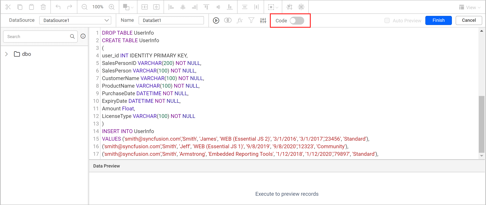

## Create query parameter

To filter user-specific data in Bold Reports<sup>®</sup>, create a parameter at the query level. Add the following `WHERE` clause statement in the query mode:

```sql
WHERE SalesPersonID = @userid
```

## Filter data using user collection

The Bold Reports<sup>®</sup> User collection provides details about the user who ran the report. To filter the sales history, you pass the salesperson ID as the value for the **user_id** parameter. Follow these steps to assign the value for the parameter:

1. Click the Parameter icon in the query designer toolbar.
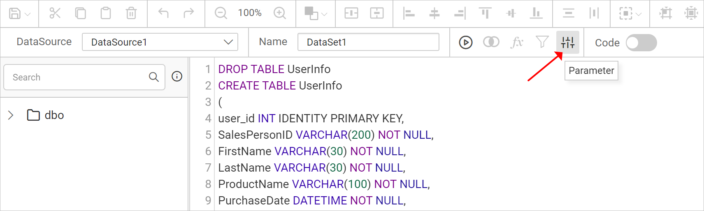
2. By default, the Parameters dialog opens with the `@user_id` parameter.
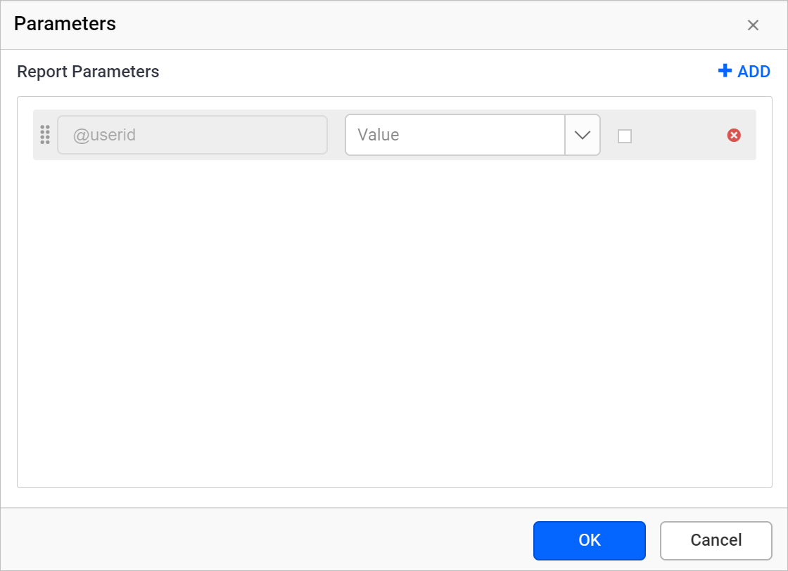
3. Click the small square icon next to the `Value` field.
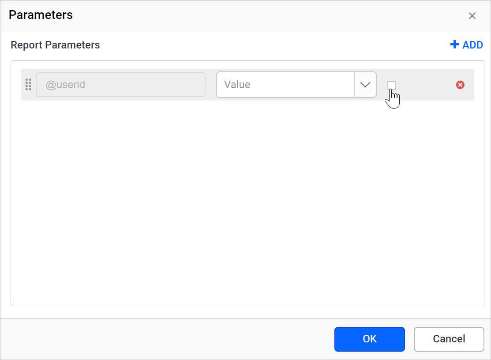
4. The expression dialog opens, as in the following image.
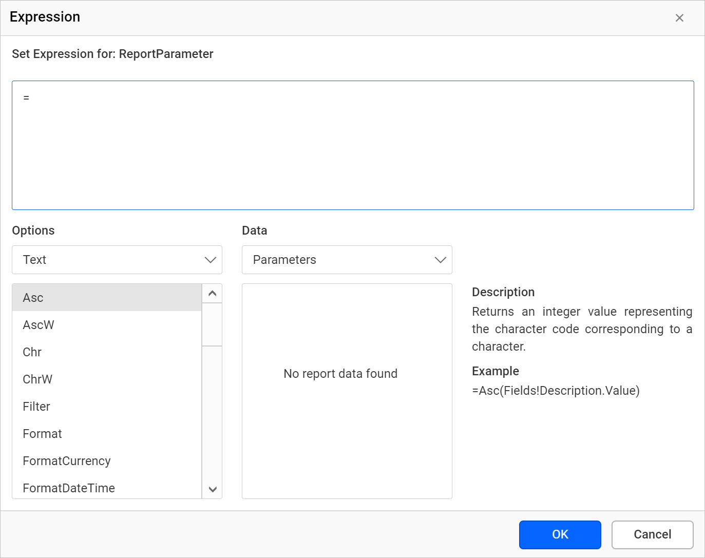
5. Enter the `=User!UserID` expression in the text area and click OK.
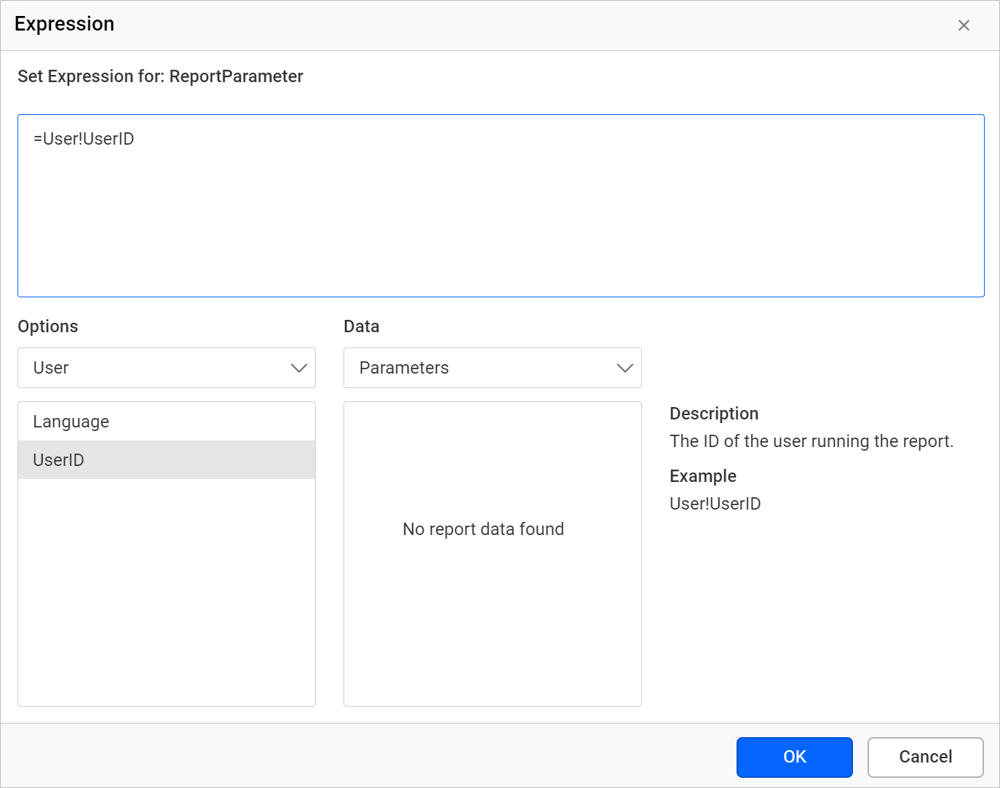
6. Click `Finish`.

When the report runs, the dataset values are filtered based on the current user who runs the report.

## Display data in table

The Bold Reports<sup>®</sup> table report item is listed in the item panel under the Data Regions category.
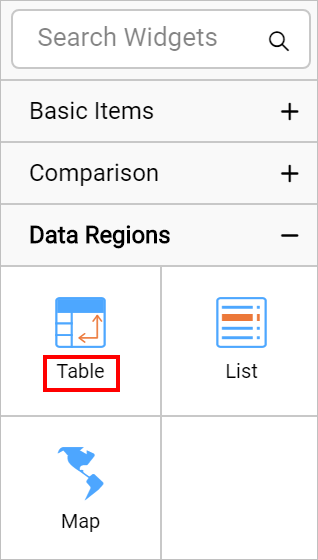

Drag and drop the table report item from the item panel into the design area.
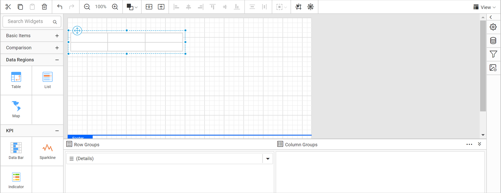

Assign the required data fields in the table cells and format the report design using the properties in the property panel. Read the [Simple Table Design](./../../../designer-guide/report-designer/report-items/tablix/design-ssrs-rdl-report-using-table/) section to learn the design steps in detail.

The following report design displays the customer name, purchase details, and sales amount achieved by a salesperson when the report runs.
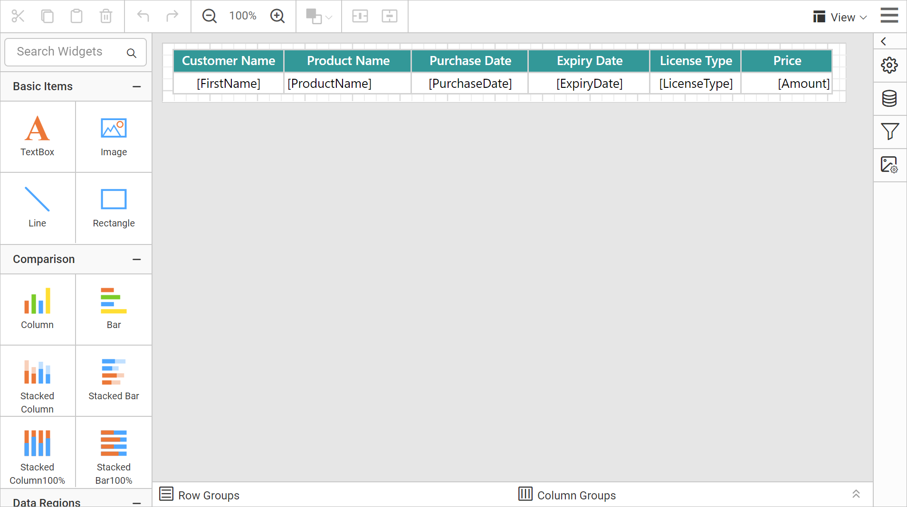

## Adding header to the report

A report header in Bold Reports<sup>®</sup> completes the design by showing the salesperson name and the report title. Follow these steps to add a header to the report:

1. Right-click the design surface and select `Add Header` from the context menu.
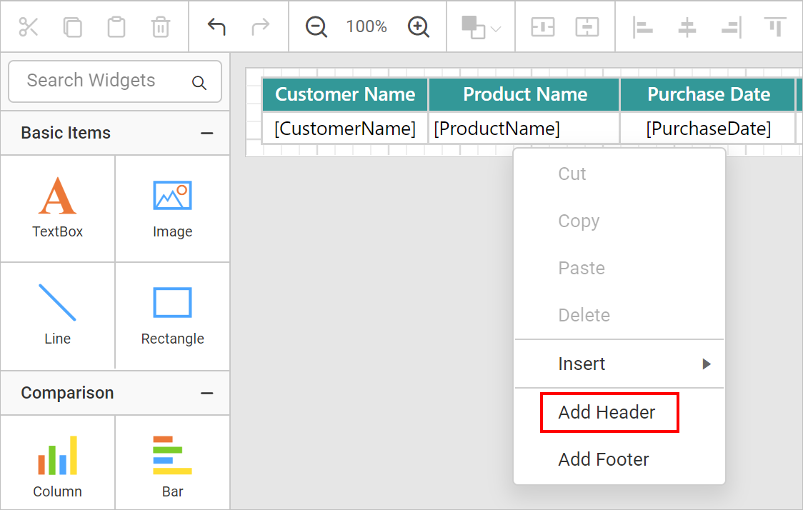
2. Drag the textbox report item to the header area to add text.
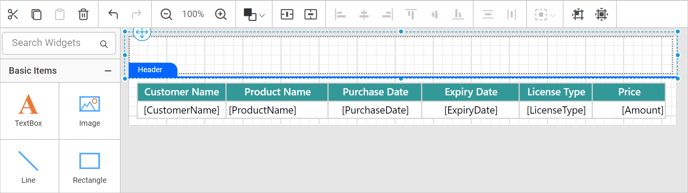
3. Right-click inside the textbox and select the `Expression` option from the context menu.
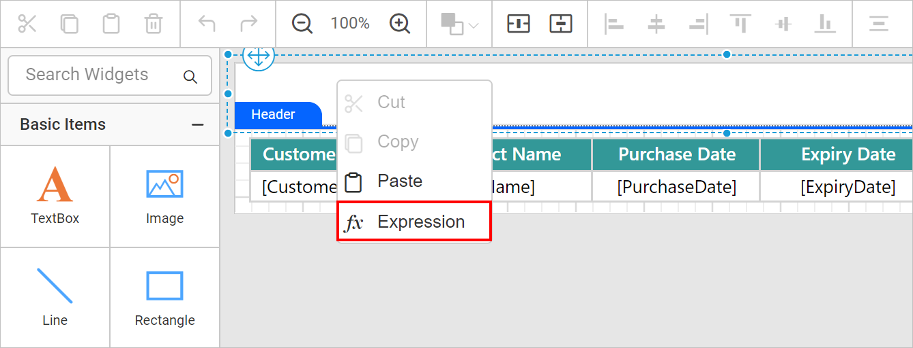
4. In the expression builder, assign the `=First(Fields!SalesPerson.Value,"DataSet1")` expression.
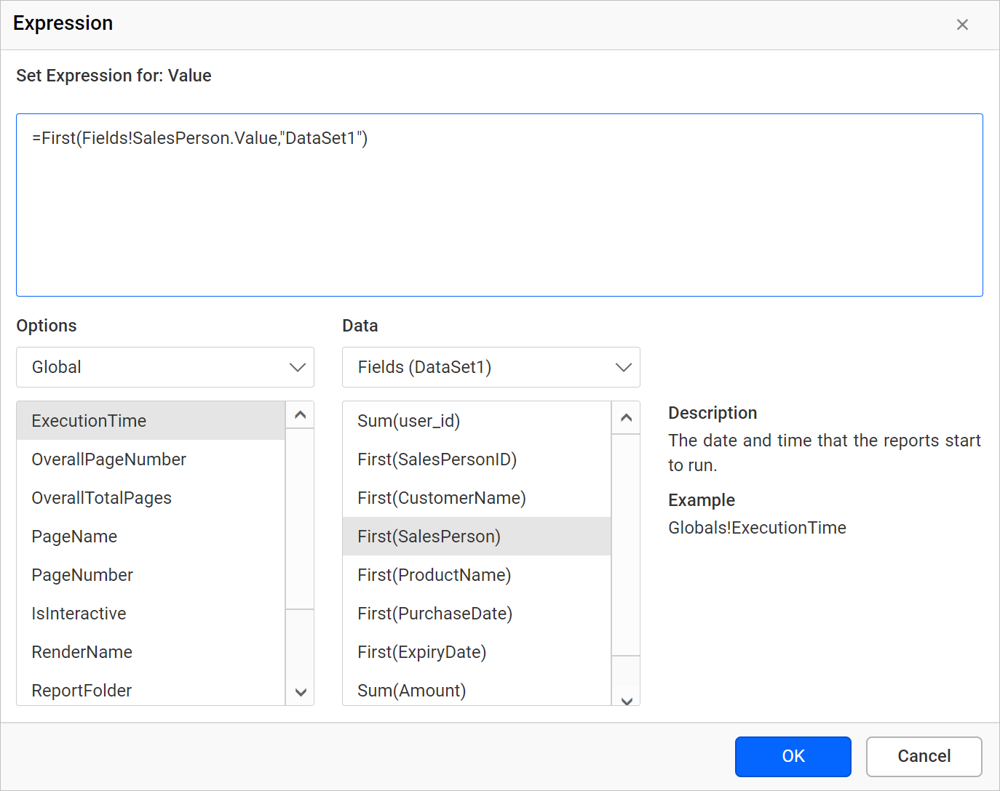
5. Click OK.
6. Enter `- Sales History` text in the text box.
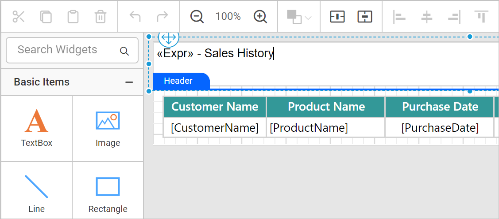

You can format the header textbox using the properties in the properties panel.

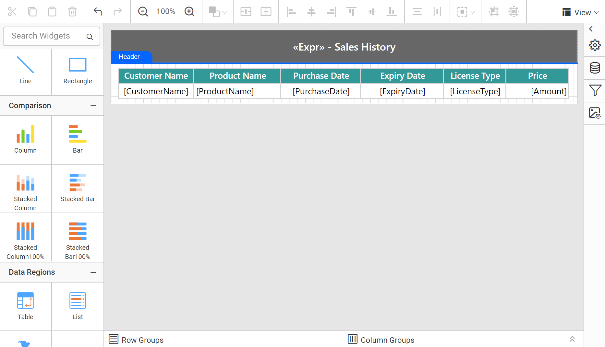

## Report Preview

When you preview the Bold Reports<sup>®</sup> report, the table displays data for the current user.

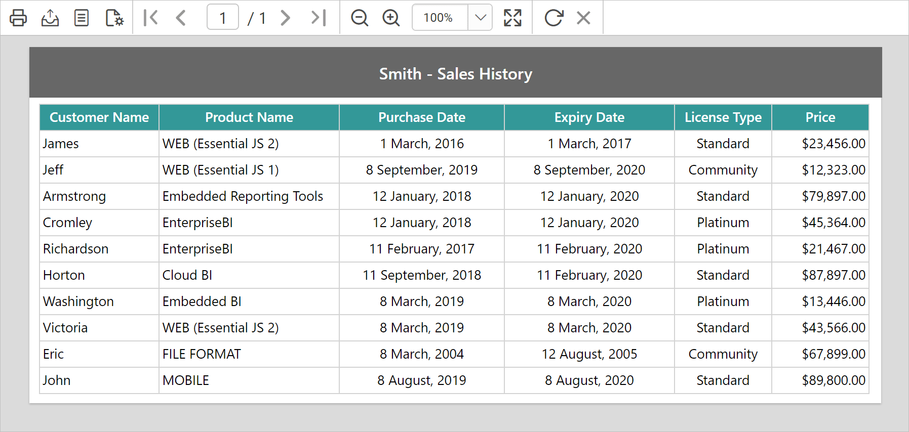

You can download the [sales history report design](https://www.syncfusion.com/downloads/support/directtrac/general/ze/saleshistory-107027917).

## Frequently asked questions

### Which expression returns the current user?

The `=User!UserID` expression from the User collection returns the user who runs the report. You assign it as the value of the query parameter.

### How does the query use the user value?

The query uses the `WHERE SalesPersonID = @userid` clause, so the dataset is filtered based on the current user who runs the report.

## See also

* [Manage data in the Report Designer](./../../../designer-guide/report-designer/manage-data/)
* [Simple table design](./../../../designer-guide/report-designer/report-items/tablix/design-ssrs-rdl-report-using-table/)
