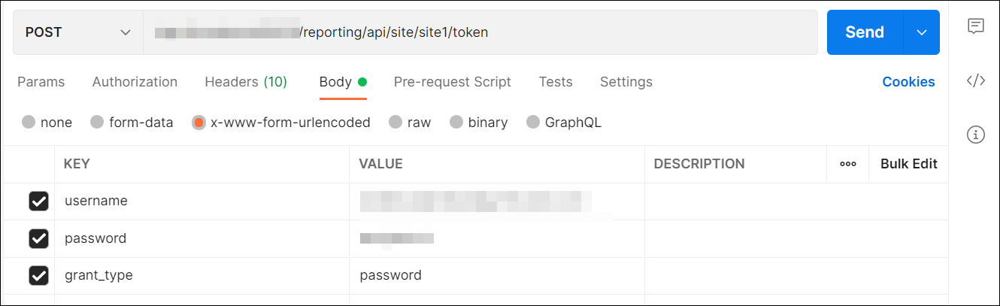
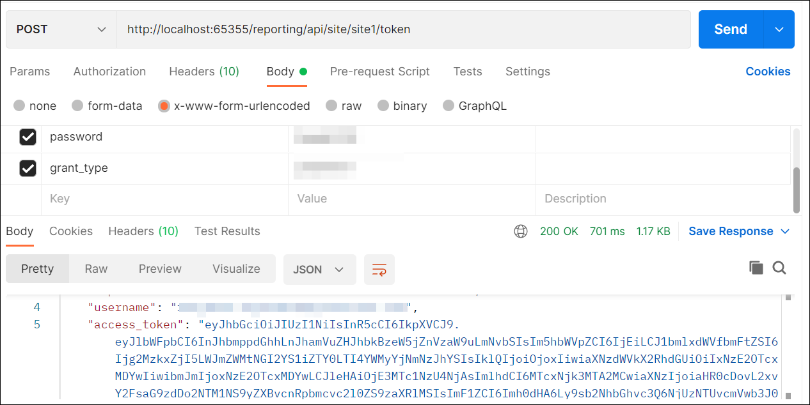

# How to generate the authentication token using API from the postman

You can generate the authentication token for a user in Bold Reports® Report Server by using the token API. To do this, you pass the user's login details in the request body.

## How do I generate a token in Postman?

You generate a Report Server token in Postman with a `POST` request to the token endpoint. Follow these steps:

1. Open the `Postman` application and create a new `POST` Http request.

2. In the request URL, provide your Report Server URL and append `reporting/api/site/{tenant-name}/token` to generate the authentication <a href="https://help.boldreports.com/enterprise-reporting/rest-api-reference/v1.0/server-api-reference/#section/Authentication" target="_blank">token</a>.

3. In the body section, add `username`, `password`, and `grant_type`. Provide the user login details, with `grant_type` set to `password`.
    

4. Click `Send`. The response contains the generated authentication token.
    

## Frequently asked questions

### Which grant type do I use for a username and password?

Set `grant_type` to `password` and pass the `username` and `password` in the request body.

## See also

* [Export a report using the API in Postman](../export-the-report-using-api/)
* [Generate the authentication token using credentials in code](../generate-authentication-token-for-bold-reports-server-using-credentials/)
