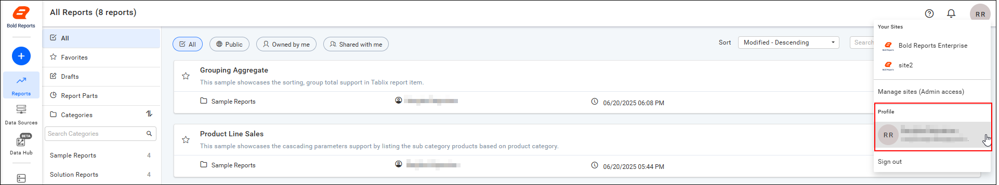
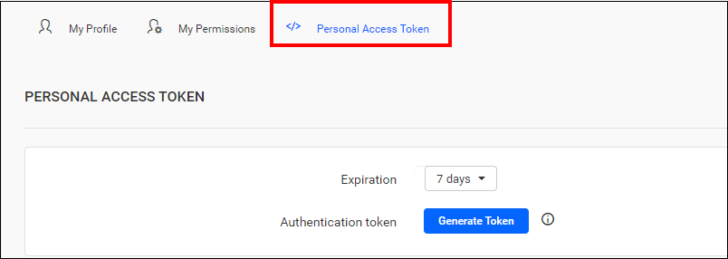
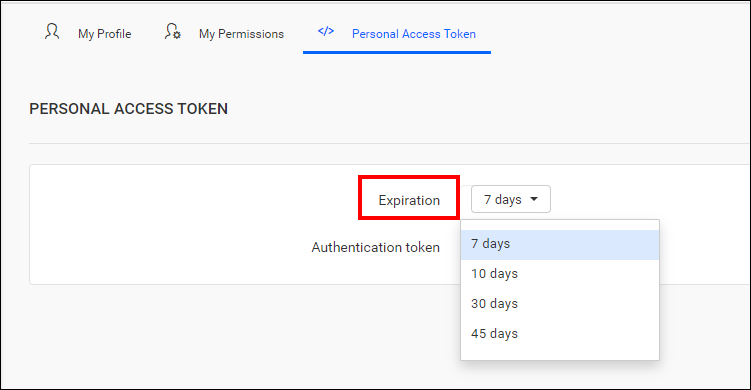
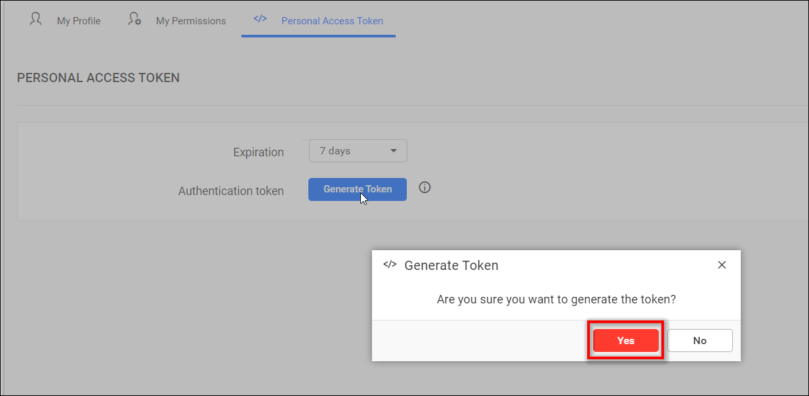
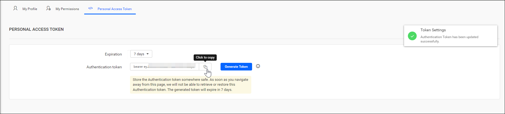

# How to generate the authentication token from Report Server UI

You can generate the authentication token for a user in the Bold Reports® Report Server UI from the `Personal Access Token` tab of the profile page.

## How do I generate a personal access token?

You generate a personal access token in Bold Reports® Report Server from your profile. Follow these steps:

1. Click the `Profile` icon in Report Server.
    

2. On the Profile page, click the `Personal Access Token` tab.
    

3. Select the required duration for token expiration from the drop-down.
    

4. Click the `Generate Token` button.
5. In the confirmation dialog, choose `Yes`.
    

6. Report Server generates an authentication token. You can copy and use this token for embedding.
    

## See also

* [Generate the authentication token using credentials](../generate-authentication-token-for-bold-reports-server-using-credentials/)
* [Generate the authentication token by using the Embed Secret Key API](../generate-authentication-token-for-user-by-using-embed-secret-key-api/)
