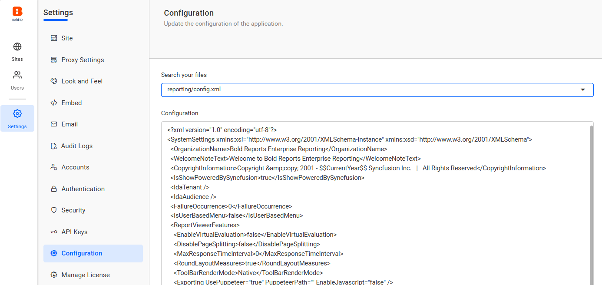

# How to get the username value from the user built-in functions in Report Server

To retrieve the username from user expressions in Bold Reports<sup>®</sup> Report Server, add the `UserBasedFilterType` tag to the `reporting/config.xml` file. The steps below enable this behavior and show the report expressions to use.

## How do I return the username from User!UserID?

You enable username values in Bold Reports<sup>®</sup> Report Server by editing `reporting/config.xml` and then using the `User!UserID` expression in your report.

1. Add the following tag to the `reporting/config.xml` file to enable user-based filtering by username:

    ```xml
    <UserBasedFilterType>username</UserBasedFilterType>
    ```
    **Path to file:**

        UMS site → Settings → Configuration → reporting/config.xml

    The following screenshot shows the reporting config file in the UMS site configuration.

    

2. **Retrieve username in report expression:**

    Use the following expression in your report to retrieve the username:

    ```rdl
    =User!UserID
    ```

3. **Append domain name (if required):**

    To display the username with a domain prefix (for example, `abc/John`), use the following expression:

    ```rdl
    ="abc/" & User!UserID
    ```

    Replace `"abc"` with your actual domain name as needed.

## Frequently asked questions

### Which file do I edit to get the username?

You edit the `reporting/config.xml` file in Report Server. Open it from **UMS site → Settings → Configuration**.

### How do I show the username with a domain prefix?

Use the expression `="abc/" & User!UserID` in your report. Replace `"abc"` with your actual domain name.

## See also

* [Filter data based on user in a report](./../filter-data-based-on-user-in-a-report/)
* [How-to guides for Enterprise Reporting](./../)
