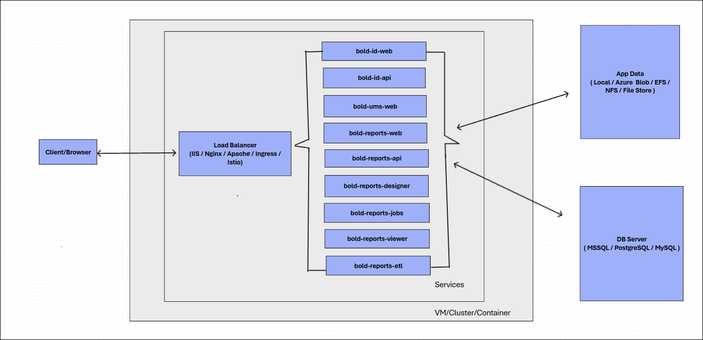
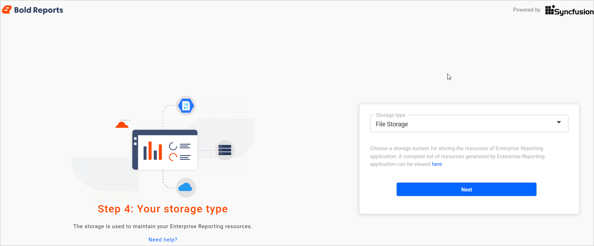
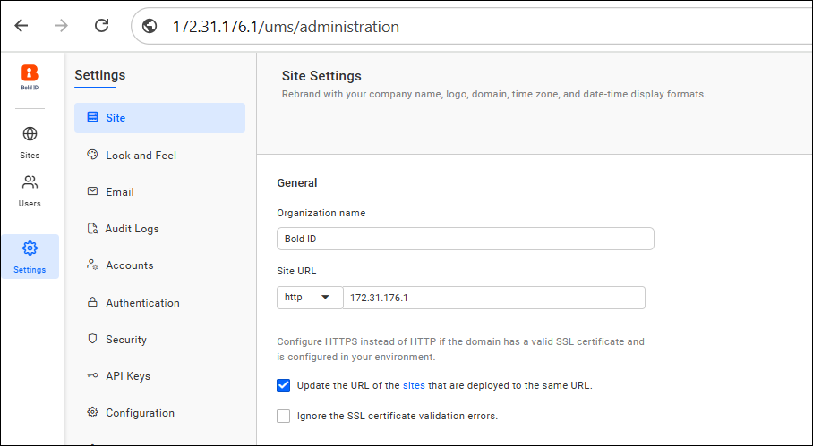

# Bold Reports® Disaster Recovery Guide

A disaster recovery (DR) plan for Bold Reports® keeps your enterprise reporting running and limits downtime during unexpected events. You back up App_Data and the databases, restore them, and point the application to the restored resources.

## Why do I need a disaster recovery plan for Bold Reports®?

A disaster recovery plan for Bold Reports® helps ensure business continuity and minimize downtime during unexpected events such as hardware failures, software crashes, or natural disasters. Therefore, having a DR plan for Bold Reports® is essential. One of the key aspects of DR is maintaining an efficient backup and restore process.

The Bold Reports® disaster recovery guide outlines the steps for creating backups, restoring data, and reconfiguring the Bold Reports® application to point to the restored resources. It emphasizes the importance of regularly backing up application data, metadata, and the IMDB database to support recovery in the event of a disaster.

By following this guide, you can help ensure business continuity by minimizing data loss and downtime during unforeseen events.

## Where does Bold Reports® store persistent data?

Bold Reports® stores persistent data in the **App_Data** directory and the database server. Knowing where Bold Reports® stores its persistent data is crucial for developing an effective backup strategy.

The following diagram shows the infrastructure architecture of Bold Reports®. It gives an overview of how the load balancer, services, application data storage, and database server interact within the system.

As the diagram shows, persistent data is stored in the **App_Data** directory and the database server. The next sections describe the type of data stored in these locations and explain their significance in disaster recovery.

### Bold Reports® Persistent Data

Bold Reports® persistent data, including users, groups, reports, schedules, and other application-related data, is stored in the following resources:

1. App_Data
2. Database Server

#### App_Data

Bold Reports® saves all report resources in the **App_Data** location. You can store App_Data with one of the following supported options:

1. File Storage
2. Azure Blob Storage

   The following screenshot shows the storage configuration options.

   

#### File Storage

File Storage typically refers to the storage that holds Bold Reports® application data. Depending on the deployment environment, it can either be local file storage or managed cloud storage.

| Environment       | App Data Location                              |
|------------------|--------------------------------------------------|
| Windows          | {Deployed Location}/BoldServices/app_data/        |
| Linux            | /var/www/bold-services/application/               |
| Docker           | Mounted Path/Mounted Storage                     |
| Kubernetes       | File Share                                       |
| Azure App Service| Azure Blob                                       |

#### Azure Blob storage

When you select the Azure Blob Storage option, Bold Reports® stores the App_Data information in the designated Azure Blob Storage.

### Database Server

The Bold Reports® database server stores the metadata and intermediate data of the Bold Reports® site. Bold Reports® supports the following databases as Meta and IMDB servers:

* MSSQL
* PostgreSQL
* MySQL

IMDB refers to the intermediate database used by the site. Back up both the metadata database and the IMDB to support a full restore.

## How do I back up and restore Bold Reports® persistent data?

You back up and restore Bold Reports® persistent resources at each place they are stored. The following sections give guidance for each location.

### Backup and Restore Persistent Data

You can back up and restore Bold Reports® persistent resources with the following steps. Based on the infrastructure diagram and the persistent data storage locations, Bold Reports® persistent information can be stored in:

* Physical or Virtual Machine - File System/Mounted Path
* Database Server - MSSQL / PostgreSQL / MySQL
* Azure Blob Storage
* ReadWriteMany Storage - SMB / NFS / EFS / File Store

### Physical or Virtual Machine

When App_Data storage uses File Storage, Bold Reports® saves the App_Data information on the hosting machine itself. Back up the App_Data location or the entire machine as needed. For a physical machine, take a backup from the following location:

| Environment | App Data Local Path                           |
|------------|------------------------------------------------|
| Windows    | {Deployed Location}/BoldServices/app_data/      |
| Linux      | /var/www/bold-services/application/             |

If you use a Virtual Machine (VM), you can either take a complete snapshot of the VM or back up only the App_Data directory listed above. The following links explain how to take and restore a VM snapshot:

| Resources | Reference Links |
|----------|------------------|
| AWS VM   | Backup: [Creating Snapshot](https://docs.aws.amazon.com/ebs/latest/userguide/ebs-creating-snapshot.html)   Restore: [Restoring an EC2 Instance](https://aws.plainenglish.io/a-step-by-step-guide-to-restoring-an-ec2-instance-from-a-snapshot-58922be4b3b6) |
| Azure VM | Backup: [Snapshot and Copy Managed Disk](https://learn.microsoft.com/en-us/azure/virtual-machines/snapshot-copy-managed-disk?tabs=portal)   Restore: [Restoring a VM from Snapshot](https://learn.microsoft.com/en-us/azure/virtual-machines/snapshot-copy-managed-disk?tabs=portal) |
| GCP VM   | Backup: [Creating Windows Persistent Disk Snapshot](https://cloud.google.com/compute/docs/instances/windows/creating-windows-persistent-disk-snapshot)   Restore: [Restoring Snapshot](https://cloud.google.com/compute/docs/disks/restore-snapshot) |

### Database Server

To back up and restore the Bold Reports® database server, use the documentation link for your database type.

#### On-premises DB Server

| Database Type | Backup and Restore Documentation |
|--------------|-----------------------------------|
| PostgreSQL   | [Backup and Restore](https://www.postgresql.org/docs/8.1/backup.html) |
| MSSQL        | [Backup and Restore of SQL Server Databases](https://learn.microsoft.com/en-us/sql/relational-databases/backup-restore/back-up-and-restore-of-sql-server-databases?view=sql-server-ver16) |
| MySQL        | [Backup and Recovery Documentation](https://dev.mysql.com/doc/refman/8.0/en/backup-and-recovery.html) |

### Managed DB Server

| Managed Database | Database Type | Backup and Restore Documentation |
|------------------|---------------|----------------------------------|
| AWS              | MySQL, MSSQL, PostgreSQL | Backup: [Create Snapshot of RDS](https://docs.aws.amazon.com/AmazonRDS/latest/UserGuide/USER_CreateSnapshot.html)   Restore: [Restore RDS from Snapshot](https://docs.aws.amazon.com/AmazonRDS/latest/UserGuide/USER_RestoreFromSnapshot.html) |
| Azure            | MySQL     MSSQL     PostgreSQL | Backup: [Backup MySQL Database](https://learn.microsoft.com/en-us/azure/backup/backup-azure-mysql-flexible-server)   Restore: [Restore MySQL Database](https://learn.microsoft.com/en-us/azure/backup/backup-azure-mysql-flexible-server-restore)    Backup: [Backup MSSQL Database](https://learn.microsoft.com/en-us/azure/backup/backup-sql-server-database-azure-vms)   Restore: [Restore MSSQL Database](https://learn.microsoft.com/en-us/azure/backup/restore-sql-database-azure-vm)  Backup: [Backup PostgreSQL Database](https://learn.microsoft.com/en-us/azure/backup/backup-azure-database-postgresql-flex)   Restore: [Restore PostgreSQL Database](https://learn.microsoft.com/en-us/azure/backup/restore-azure-database-postgresql-flex) |
| GCP              | MySQL     MSSQL     PostgreSQL | Backup: [Backup MySQL Database](https://cloud.google.com/sql/docs/mysql/backup-recovery/backing-up)   Restore: [Restore MySQL Database](https://cloud.google.com/sql/docs/mysql/backup-recovery/restoring)   Backup: [Backup MSSQL Database](https://cloud.google.com/sql/docs/sqlserver/backup-recovery/backups)   Restore: [Restore MSSQL Database](https://cloud.google.com/sql/docs/sqlserver/backup-recovery/restore)  Backup: [Backup PostgreSQL Database](https://cloud.google.com/sql/docs/postgres/backup-recovery/backups)   Restore: [Restore PostgreSQL Database](https://cloud.google.com/sql/docs/postgres/backup-recovery/restore) |

### Azure Blob Storage

If you configured Azure Blob Storage during the Bold Reports® site setup, you must back up the Azure Blob Storage data.

| Azure Blob |
|------------|
| Backup: [Configure and Manage Blob Backup](https://learn.microsoft.com/en-us/azure/backup/blob-backup-configure-manage)   Restore: [Blob Restore](https://learn.microsoft.com/en-us/azure/backup/blob-restore) |

### ReadWriteMany Storage

For a Kubernetes deployment, you mount the ReadWriteMany persistent volume to store Bold Reports® App_Data information. Use the documentation link for your cloud provider to back up and restore the ReadWriteMany storage volume.

| Cloud Storage                | Backup and Restore Documentation |
|-----------------------------|----------------------------------|
| Elastic File Storage for EKS| [AWS Backup Documentation](https://docs.aws.amazon.com/efs/latest/ug/awsbackup.html) |
| Azure File Share for AKS    | [Azure File Share Backup](https://learn.microsoft.com/en-us/azure/backup/backup-afs) |
| GKE File Store for GKE      | [File Store Backup](https://cloud.google.com/filestore/docs/backup-restore) |

## What do I change after restoring Bold Reports® resources?

After you restore the persistent data resources, make changes at the environment and Bold Reports® application levels so the application uses them.

### List of Changes Required to Use Restored Resources

Make the following changes to point Bold Reports® to the restored App_Data, databases, and server address.

#### Restore the App_Data

| Deployed In      | Restore |
|------------------|---------|
| Physical Machine | Replace the backed-up files in the installed **App_Data** directory. |
| Cloud VM         | If you restore the VM from the snapshot, you need to make domain or IP changes at the application level as described below. However, if you only restored the **App_Data** directory, you can skip the domain or IP changes. |
| Docker           | Replace the backed-up files in the container-mounted host path. |
| Kubernetes       | Update the restored persistent volume details (Azure File Share/EFS filesystem/Google Filestore) in the deployment manifest or Helm chart, and redeploy the application. |

#### Update Database Connection String

You update the Bold Reports® database connection string when the restored databases are on another server.

* To update the database connection string, use the guidance document below to reset it for different environments.
* If you backed up the database on another server and the database name remains the same, the [KB article on updating tenant database information in bulk](https://support.boldreports.com/kb/article/19539/how-to-update-the-tenant-database-information-in-bulk-in-on-premise-deployments) is sufficient to update both the UMS and tenant databases.
* If you backed up the databases on another server with different names, follow both the KB article above and the documentation linked below:
  [Reset Application Database](https://help.boldreports.com/enterprise-reporting/utilities/reset-application-database/)

#### Change Domain Mapping or IP Binding

You update the Bold Reports® domain mapping or IP binding when the server address changes after a restore.

* If you use a domain name and restore the server from a snapshot, map the new IP address to the same domain name.
* If you host the application using an IP address and the server IP has changed, update the IP address in the UMS administration page.
  1. Navigate to **URL/ums/administration** in the browser.
  2. Verify that the new URL is updated.
  3. If not, update the new URL on the administration page and save the changes.

  The following screenshot shows the URL setting on the site administration page.

  

## Frequently asked questions

### Which databases do I back up for Bold Reports®?

Back up both the metadata database and the IMDB to support a full restore. Bold Reports® supports MSSQL, PostgreSQL, and MySQL for these servers.

### Where is App_Data stored on Windows and Linux?

On Windows, App_Data is in `{Deployed Location}/BoldServices/app_data/`. On Linux, it is in `/var/www/bold-services/application/`.

### Do I need to change the domain or IP after restoring only App_Data?

No. If you only restored the **App_Data** directory on a cloud VM, you can skip the domain or IP changes.

## See also

* [Security in Bold Reports®](./../security/)
* [Reset the application database utility](./../utilities/reset-application-database/)
* [Enterprise license validation](./../licensing/)
