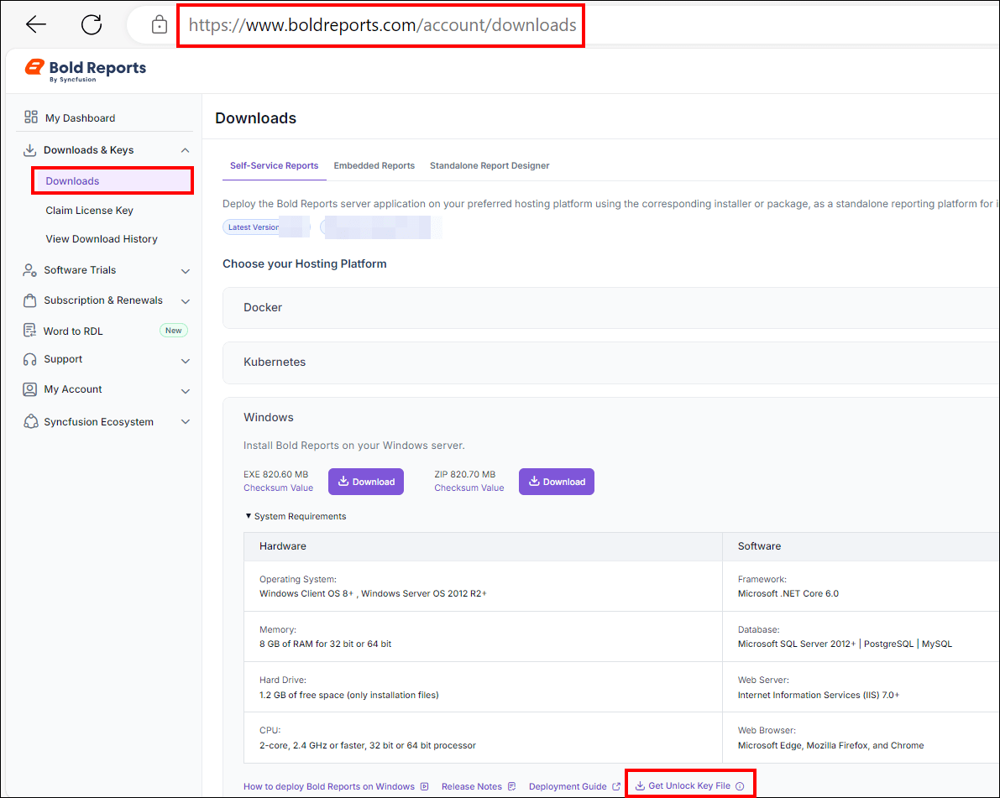
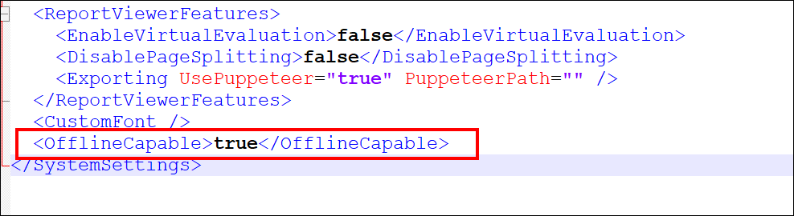

# Bold Reports<sup>®</sup> Enterprise License Overview

A Bold Reports<sup>®</sup> enterprise license grants a large organization the right to use the Bold Reports<sup>®</sup> software product across the entire business. An enterprise license, including those for Bold Reports<sup>®</sup>, is a type of software licensing agreement.

## What is a Bold Reports<sup>®</sup> enterprise license?

A Bold Reports<sup>®</sup> enterprise license allows organizations to use the Bold Reports<sup>®</sup> software or service across the entire organization. You do not need to obtain individual licenses for each user or device.

**Key characteristics of an enterprise license often include:**

1. Bold Reports<sup>®</sup> can be installed and used on any number of devices within the organization, without restrictions on the number of users or installations.

2. The organization can manage all licenses centrally, making it easier to track usage, renewals, and compliance.

3. Enterprise licenses often come with access to additional services, such as premium support.

4. Compared to purchasing individual licenses for each user or device, enterprise licensing offers cost efficiency. This could involve a flat fee, a pricing structure based on the organization’s size, or a usage-based model.

## Which license validation types does Bold Reports<sup>®</sup> support?

Bold Reports<sup>®</sup> supports two types of license validation:

1. [Online License Validation](#online-license-validation)

2. [Offline License Validation](#offline-license-validation)

## Online License Validation

* Online license validation is a process used by Bold Reports<sup>®</sup> to verify the authenticity and legality of a Bold Reports<sup>®</sup> license by connecting to the internet. It ensures that the provided Bold Reports<sup>®</sup> license key or credentials are legitimate before allowing Bold Reports<sup>®</sup> to operate or granting access to certain features.

* To activate your account and start the Bold Reports<sup>®</sup> Enterprise Application using online license validation, use your login credentials. For detailed instructions, see [activate the account using login credentials](./../application-startup/#activate-the-account-using-login-credentials).

### How does online license validation work?

Bold Reports<sup>®</sup> online license validation checks your license key or credentials against a designated server over the internet.

1. When a user installs or activates Bold Reports<sup>®</sup>, they are required to enter a license key or credentials for authorization.

2. Bold Reports<sup>®</sup> initiates a request to its designated server over the internet, transmitting details about the license key or credentials.

3. The server checks the provided license key or credentials to verify whether they are genuine, unused, and aligned with the authorized usage rights.

4. If the license key meets the criteria and is valid, Bold Reports<sup>®</sup> is authorized to run or access various features according to the terms of the license agreement.

### Why does Bold Reports<sup>®</sup> use online license validation?

Bold Reports<sup>®</sup> uses online license validation for the following purposes:

1. **Anti-Piracy Measure:** Online validation helps prevent Bold Reports<sup>®</sup> piracy by ensuring that only genuine and authorized license keys are accepted, reducing unauthorized usage or distribution.

2. **Ensuring Compliance:** Online validation ensures users adhere to Bold Reports<sup>®</sup> license terms and conditions, allowing Bold Reports<sup>®</sup> providers to monitor and regulate authorized software use.

3. **Security Enhancement:** Online license validation adds a layer of security. Only legitimate users with authorized licenses can access Bold Reports<sup>®</sup>, which reduces the risk of unauthorized access or security breaches.

4. **Subscription Model:** Online validation supports a subscription-based model by periodically verifying licenses to ensure that users maintain active subscriptions or licenses for continued access.

## Offline License Validation

* Offline license validation, including for Bold Reports<sup>®</sup>, involves authenticating the legitimacy of a Bold Reports<sup>®</sup> software license without requiring an active internet connection. It verifies the validity and authenticity of a provided Bold Reports<sup>®</sup> license key or credentials locally on the device without connecting to a central server or online system.

* By default, the Bold Reports<sup>®</sup> license requires online license validation. If network limitations or other barriers block online validation, you can obtain an offline license key for your subscription.

### How does offline license validation work?

Bold Reports<sup>®</sup> offline license validation checks your license key or credentials directly on your device.

1. The process authenticates the license key or credentials directly on the user’s device, checking their validity without requiring an internet connection.

2. Bold Reports<sup>®</sup> compares the provided license key or credentials against locally stored data or cryptographic methods to ensure they are genuine and in line with Bold Reports<sup>®</sup> licensing terms.

3. The license key or credentials for Bold Reports<sup>®</sup> must be valid and meet the validation criteria. When they do, Bold Reports<sup>®</sup> is authorized to run or access specific features as per the terms of the license agreement.

### When should I use offline license validation?

Bold Reports<sup>®</sup> offline license validation suits the following situations:

1. **Limited Internet Access:** Offline validation is beneficial in environments with limited or no internet connectivity, ensuring Bold Reports<sup>®</sup> activation and usage without requiring an online connection.

2. **Secure Environments:** For highly secure environments, closed networks, or systems isolated from the internet for security reasons, offline validation ensures Bold Reports<sup>®</sup> activation without compromising security.

3. **Remote Locations:** In areas with poor connectivity, offline validation allows Bold Reports<sup>®</sup> usage without depending on internet availability.

4. **Confidentiality and Privacy:** Offline validation offers a layer of privacy by verifying licenses locally, without transmitting sensitive license information over the internet.

5. **Reduced Dependency:** Offline validation reduces reliance on continuous internet access for license validation, making it convenient for users operating in offline or restricted network environments.

### How do I get the offline unlock key file?

You generate the Bold Reports<sup>®</sup> unlock key file (`.lic`) from the [Bold Reports<sup>®</sup> account Downloads page](https://www.boldreports.com/account/downloads?tab=self-service). The option becomes available after offline license support is activated.

* To enable offline license access, submit an activation request through the [Bold Reports<sup>®</sup> support system](https://support.boldreports.com/) or contact the sales team at (sales@syncfusion.com).
* For more information, see the [KB article on obtaining the offline unlock key file](https://support.boldreports.com/kb/article/17608/how-do-i-obtain-the-offline-unlock-key-file-from-our-bold-reports-account-page).

   The following screenshot shows where you get the unlock key file on the Downloads page.

   

### Where do I place the offline unlock key file?

Place the downloaded Bold Reports<sup>®</sup> unlock key file in the Bold Reports<sup>®</sup> installation location. Follow these steps:

1. The offline unlock file should have the name `boldreports_components_licensekey.lic`.

2. Go to the deployed location and place the unlock key file in the following location:

   **`{Deployed Location}`**\app_data\reporting\configuration

   Example: C:\BoldServices\app_data\reporting\configuration

   > By default, Bold Reports<sup>®</sup> is deployed at C:\BoldServices.

3. Open the `config.xml` file at the following location:  
   `{deployment_location}\app_data\reporting\configuration\config.xml`

4. Set the `OfflineCapable` node to `true`. If the node is not available, add it and then save the file:
   `<OfflineCapable>true</OfflineCapable>`  
   For more information, see the [KB article on enabling offline mode for Bold Reports<sup>®</sup>](https://support.boldreports.com/kb/article/14885/enable-offline-mode-for-bold-reports-resolve-errors-when-an-internet-connections-are-not-available).

   The following screenshot shows the `OfflineCapable` node in the `config.xml` file.

   

5. [Restart the Bold Reports<sup>®</sup> Enterprise application](./../administrator-guide/faq/how-to-restart-the-bold-reports-enterprise-application/).

   ```steps
   The unlock key expires based on the validity of the subscription.

   After the expiration date, you must renew your subscription and update the unlock key.

> **Note:** You can change your Bold Reports<sup>®</sup> license by following the [activate Bold Reports<sup>®</sup> license documentation](./../application-startup/#activate-bold-reports-license).
