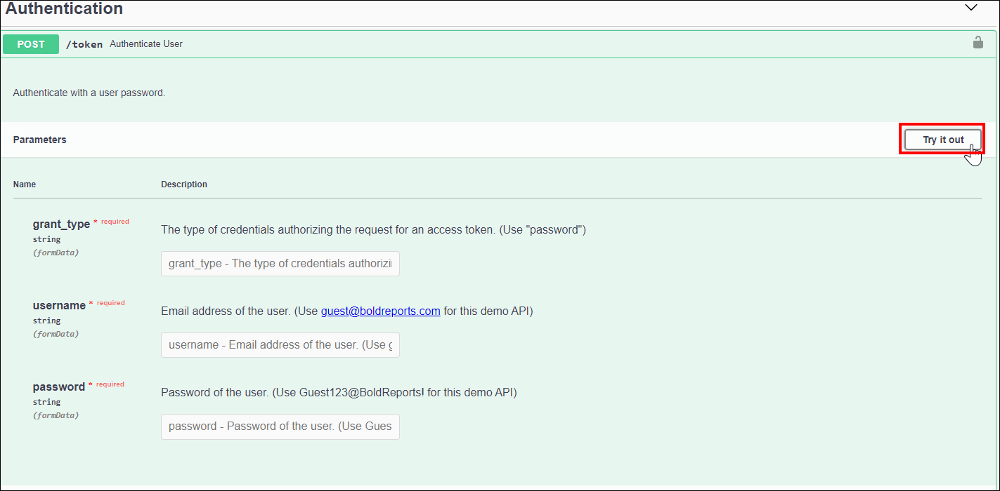
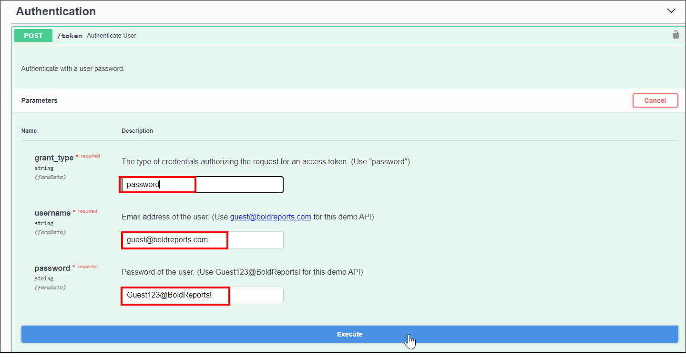
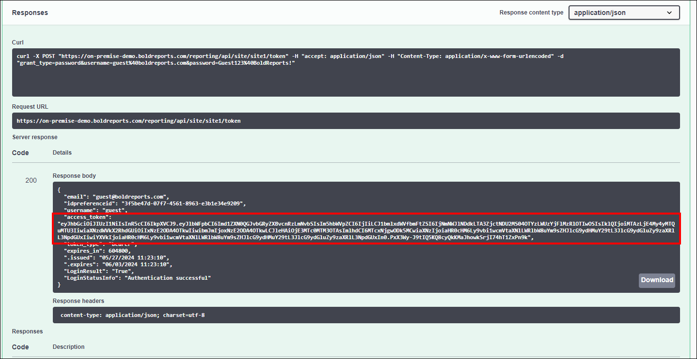
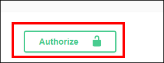
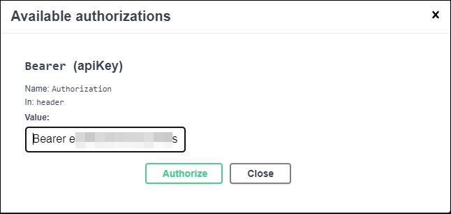
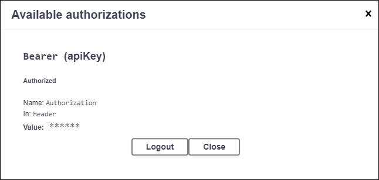

# Interact with the Bold Reports® REST API

To use the Bold Reports® interactive REST API documentation, get a user access token and add it to the header of each request. You need an access token to authenticate with the API endpoints and get responses.

## How do I get an access token?

Each Bold Reports® Report Server user has their own unique token to authenticate requests. Add this token to the header of the request.

To obtain the **User Token**, follow these steps:

1. Navigate to the appropriate interactive REST API documentation link.
     * <a href="https://help.boldreports.com/enterprise-reporting/rest-api-reference/v1.0/try-it-now/" target="_blank">v1.0</a>
     * <a href="https://help.boldreports.com/enterprise-reporting/rest-api-reference/v2.0/try-it-now/" target="_blank">v2.0</a>
     * <a href="https://help.boldreports.com/enterprise-reporting/rest-api-reference/v3.0/try-it-now/" target="_blank">v3.0</a>
     * <a href="https://help.boldreports.com/enterprise-reporting/rest-api-reference/v4.0/try-it-now/" target="_blank">v4.0</a>
     * <a href="https://help.boldreports.com/enterprise-reporting/rest-api-reference/v5.0/try-it-now/" target="_blank">v5.0</a>

2. Expand the `Authentication` section and click `Try it out`.
   
3. A public demo of the Bold Reports® Report Server is hosted at the [adhoc.boldreports.com demo site](https://adhoc.boldreports.com). To use the public demo, obtain the access token using the sample credentials provided below.

     Username - guest@boldreports.com

     grant_type - password

     password - Guest123@BoldReports!

   

4. Click `Execute`. You receive a response similar to the one below. Retrieve the `access_token` from the response body.
     

## How do I authorize API requests with the token?

You authorize Bold Reports® REST API calls by including the access_token as an Authorization header for subsequent API calls.

1. Click the `Authorize` button in the top right corner of the page.
     

2. In the dialog that opens, enter the access token in the `Value` box with this format, **'Bearer' + access_token**, then click the `Authorize` button.

     
     

3. You can now interact with the other REST APIs using the respective parameters described in each API's documentation.

> **NOTE:** The Bold Reports® interactive document provides both API responses and their corresponding code descriptions.

## See also

* [Report Server REST API reference](../)
* [Generate an authentication token using the API](../../developer-guide/how-to/generate-authentication-token-for-bold-reports-server-using-api/)
* [Export a report using the API](../../developer-guide/how-to/export-the-report-using-api/)
