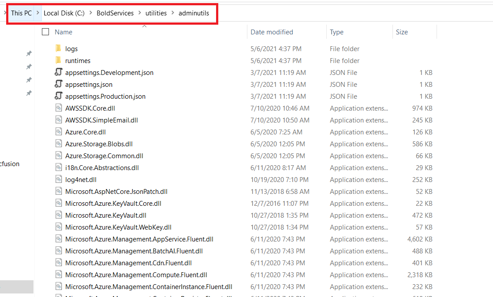
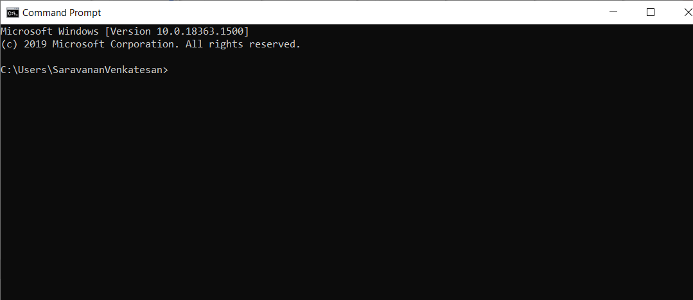
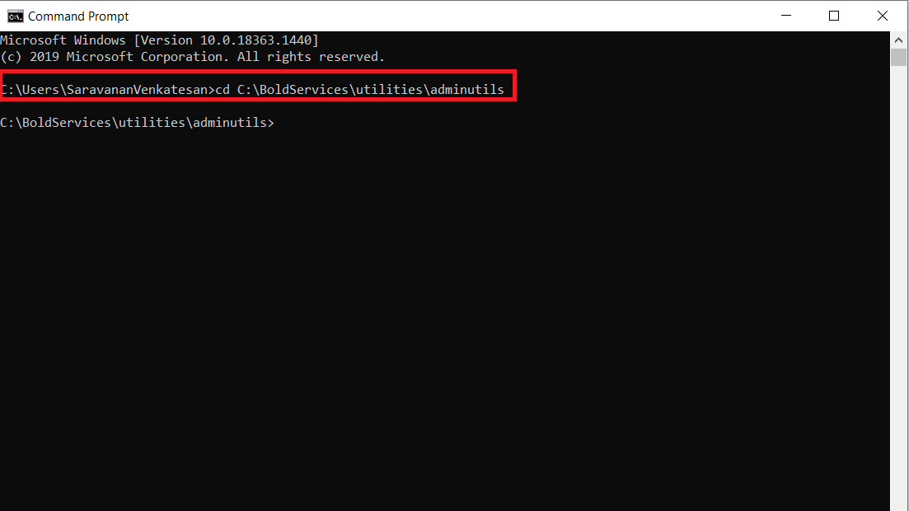

# Bold Reports<sup>®</sup> Admin Utility

The Bold Reports<sup>®</sup> admin utility is a command-line tool that you run from the `{Deployed Location}`\utilities\adminutils folder to perform administrative tasks.

 >**NOTE:** If you installed Bold Reports<sup>®</sup> version 2.4 or older, see the [Admin Utility for version 2.4 or older](./../utilities/v2.4-or-older/).

## How do I use the admin utility?

You run the Bold Reports<sup>®</sup> admin utility from a command prompt opened in the admin utility location.

* Switch the admin utility location to `{Deployed Location}`\utilities\adminutils. The following screenshot shows the admin utility folder.
   
   > **NOTE:** By default, Bold Reports<sup>®</sup> will be deployed on `C:\BoldServices`.

* Open the command prompt.
   

* Change the command prompt directory to the admin utility location with the following command:

   ```sh
   cd C:\BoldServices\utilities\adminutils.
   ```

   

## Which commands does the admin utility support?

The Bold Reports<sup>®</sup> admin utility supports the following commands:
* [**Reset Password**](./../utilities/reset-password/)
* [**Update Application Database**](./../utilities/reset-application-database/)
* [**Reset 2FA**](./../utilities/reset-two-factor-authentication/)

## See also

* [Disaster recovery guide](./../disaster-recovery/)
* [Security in Bold Reports<sup>®</sup>](./../security/)
