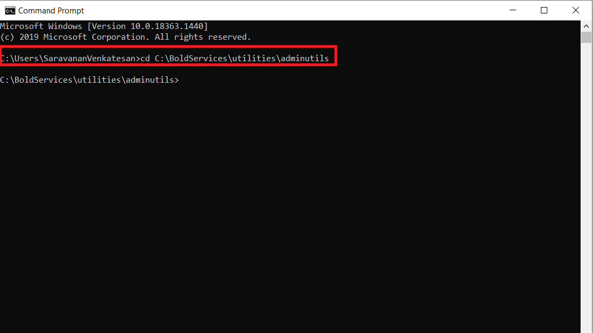
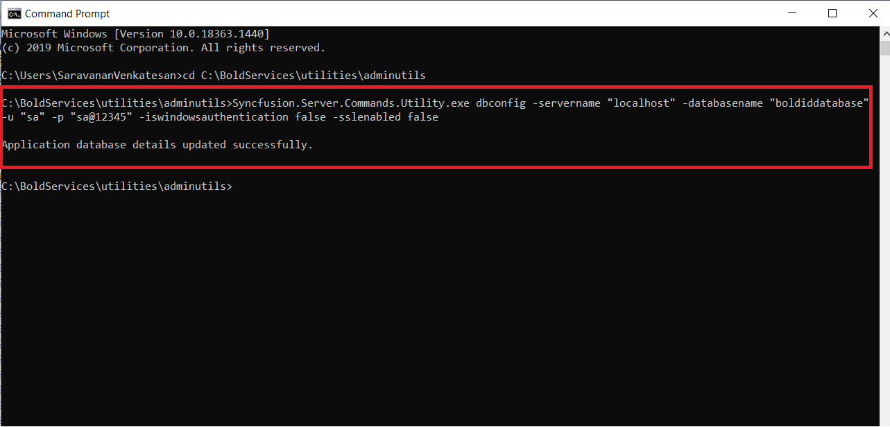
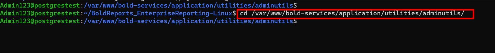
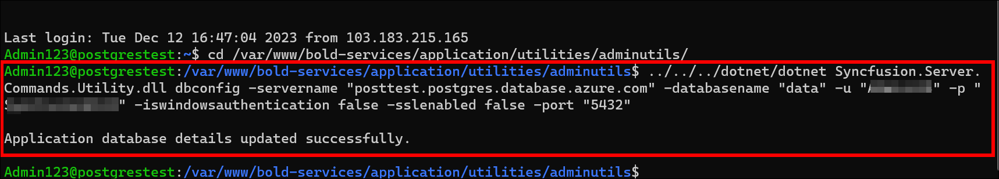
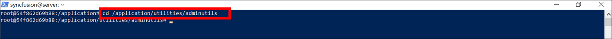
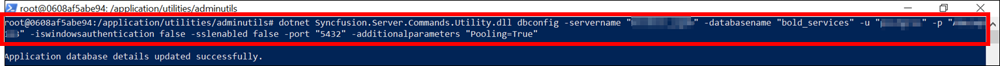

# Reset the Bold Reports<sup>®</sup> Application Database

You can reset the Bold Reports<sup>®</sup> application database with the admin utility `dbconfig` command. Use the steps for your operating system or platform:
* [Windows](#windows)
* [Linux](#linux)
* [Docker](#docker)
* [Kubernetes](#kubernetes)

## Windows

To reset the Bold Reports<sup>®</sup> application database on Windows, run the admin utility from the command prompt and then restart the application in IIS.

1. Open the command prompt and change the directory to the admin utility location.

   ```sh
   cd C:\BoldServices\utilities\adminutils
   ```

   The following screenshot shows the command prompt in the admin utility location.

   

2. Run the following command to reset the database:

   ```sh
   Syncfusion.Server.Commands.Utility.exe dbconfig -servername "localhost" -databasename "BoldReportsMasterDatabase" -u "Admin" -p "Admin@12345" -iswindowsauthentication false -sslenabled false
   ```

    > **IMPORTANT:**  command details:

    servername - SQL server hostname/IP

    databasename – SQL database name

    u – SQL server username

    p – SQL server password

    port - port number of SQL Server(Required PostgreSQL only)

    iswindowsauthentication – Is windows authentication required (this is optional)

    sslenabled – Is encrypted connection required (this is optional)

   

3. After the database updates successfully, restart the application in [IIS](../../administrator-guide/faq/how-to-restart-the-bold-reports-enterprise-application/#windows).

## Linux

To reset the Bold Reports<sup>®</sup> application database on Linux, run the admin utility through `dotnet` and then restart the application.

1. Open the command prompt and change the directory to the admin utility location.

   ```sh
   cd /var/www/bold-services/application/utilities/adminutils/
   ```

   

2. Run the following command to reset the database:

   ```sh
   ../../../dotnet/dotnet Syncfusion.Server.Commands.Utility.dll dbconfig -servername "localhost" -databasename "BoldReportsMasterDatabase" -u "Admin" -p "Admin@12345" -iswindowsauthentication false -sslenabled false -port "5432"
   ```

   > **IMPORTANT:**  command details:

   servername – SQL server hostname/IP

   databasename – SQL database name

   u – SQL server username

   p – SQL server password

   port - Port number required for PostgreSQL and MySQL

   iswindowsauthentication – Is windows authentication required (Required for MSSQL only)

   sslenabled – Is encrypted connection required (this is optional)

   

3. After the database updates successfully, restart the application by following the steps in [how to restart the Bold Reports<sup>®</sup> Enterprise application on Linux](../../administrator-guide/faq/how-to-restart-the-bold-reports-enterprise-application/#linux).

## Docker

To reset the Bold Reports<sup>®</sup> application database on Docker, run the admin utility inside the container and then restart the container or containers.

### How do I reset the database in a single container image?

For a Bold Reports<sup>®</sup> single container image, run the admin utility inside that container.

1. Open the command prompt and bash the container, then change the directory to the admin utility location.

   ```sh
   docker exec -it <Container ID or Container name>
   ```

   ```sh
   cd /application/utilities/adminutils/
   ```

   

2. Run the following command to reset the database:

   ```sh
   dotnet Syncfusion.Server.Commands.Utility.dll dbconfig -servername "localhost" -databasename "BoldReportsMasterDatabase" -u "Admin" -p "Admin@12345" -iswindowsauthentication false -sslenabled false -port "5432" -additionalparameters "Pooling=True"
   ```

   

3. After the database updates successfully, restart the application by using the following command:

   ```sh
   docker restart <container ID or container name>
   ```

### How do I reset the database in a multi container image?

For a Bold Reports<sup>®</sup> multi container image, run the admin utility in the `id_web_container` container and then restart all containers.

1. Open the command prompt and bash the `id_web_container` container, then change the directory to the admin utility location.

   ```sh
   docker exec -it <Container ID or Container name>
   ```

   ```sh
   cd /application/utilities/adminutils/
   ```

   

2. Run the following command to reset the database:

   ```sh
   dotnet Syncfusion.Server.Commands.Utility.dll dbconfig -servername "localhost" -databasename "BoldReportsMasterDatabase" -u "Admin" -p "Admin@12345" -iswindowsauthentication false -sslenabled false -port "5432" -additionalparameters "Pooling=True"
   ```

   > **IMPORTANT:**  command details:

   servername – SQL server hostname/IP

   databasename – SQL database name

   u – SQL server username

   p – SQL server password

   port - Port number required for PostgreSQL and MySQL

   iswindowsauthentication – Is windows authentication required (Required for MSSQL only)

   sslenabled – Is encrypted connection required (this is optional)

   additionalparameters - Additional parameters required for database connection (this is optional)

   
3. After the database updates successfully, restart all containers by using the following commands:

   ```sh
   docker ps
   ```

   ```sh
   docker restart <container ID or container name>
   ```

   > **Note:** Restart all seven containers using the command above, one by one, from the container name or ID.

## Kubernetes

To reset the Bold Reports<sup>®</sup> application database on Kubernetes, run the admin utility in the `id_web_deployment` pod and then restart the deployment.

1. Open the command prompt and bash the `id_web_deployment` pod, then change the directory to the admin utility location.

   ```sh
   kubectl exec -it <id-web-deployment-pod> -n namespace -- bash
   ```

   ```sh
   cd /application/utilities/adminutils/
   ```

   
2. Run the following command to reset the database:

   ```sh
   dotnet Syncfusion.Server.Commands.Utility.dll dbconfig -servername "localhost" -databasename "BoldReportsMasterDatabase" -u "Admin" -p "Admin@12345" -iswindowsauthentication false -sslenabled false -port "5432" -additionalparameters "Pooling=True"
   ```

   > **IMPORTANT:**  command details:

   servername – SQL server hostname/IP

   databasename – SQL database name

   u – SQL server username

   p – SQL server password

   port - Port number required for PostgreSQL and MySQL

   iswindowsauthentication – Is windows authentication required (Required for MSSQL only)

   sslenabled – Is encrypted connection required (this is optional)

   additionalparameters - Additional parameters required for database connection (this is optional)

   
3. After the database updates successfully, restart the application using the following command:

   ```sh
   kubectl rollout restart deploy -n <namespace>
   ```

## Frequently asked questions

### Which admin utility command resets the application database?

The `dbconfig` command of the Bold Reports<sup>®</sup> admin utility resets the application database. You pass the server name, database name, username, and password.

### When do I need the port parameter?

On Linux, Docker, and Kubernetes, the port number is required for PostgreSQL and MySQL.

### How many containers do I restart in a multi container image?

Restart all seven containers, one by one, from the container name or ID.

## See also

* [Admin utility overview](../)
* [Reset a user password](../reset-password/)
* [Disaster recovery guide](../../disaster-recovery/)
