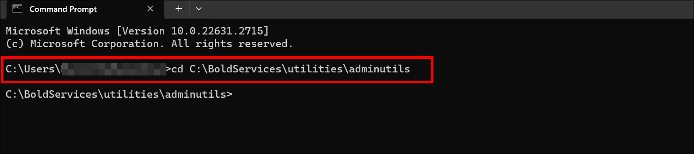
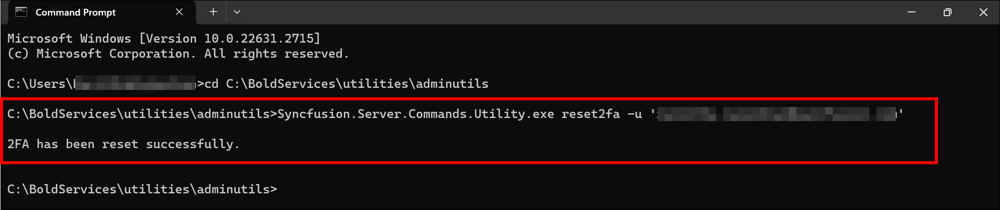
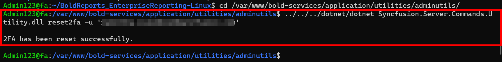

# Reset Two-Factor Authentication for a Bold Reports<sup>®</sup> User

You can reset the two-factor authentication of any Bold Reports<sup>®</sup> user with the admin utility `reset2fa` command, using their email address or username. Follow the steps for your platform:

* [Windows](#windows)
* [Linux](#linux)

## Windows

To reset two-factor authentication for a Bold Reports<sup>®</sup> user on Windows, run the admin utility `reset2fa` command from the command prompt.

1. Open the command prompt and change the directory to the admin utility location.

   ```sh
   cd C:\BoldServices\utilities\adminutils
   ```

   

2. Run the following command to reset Two-Factor Authentication:

   ```sh
   Syncfusion.Server.Commands.Utility.exe reset2fa -u 'user email or username here'
   ```

    

3. After Two-Factor Authentication resets successfully, the user can log in without Two-Factor Authentication.

## Linux

To reset two-factor authentication for a Bold Reports<sup>®</sup> user on Linux, run the admin utility `reset2fa` command through `dotnet`.

1. Change the directory to the admin utility location.

   ```sh
   cd /var/www/bold-services/application/utilities/adminutils/
   ```

   

2. Run the following command to reset Two-Factor Authentication:

   ```sh
   ../../../dotnet/dotnet Syncfusion.Server.Commands.Utility.dll reset2fa -u 'user email or username here'
   ```

    

3. After Two-Factor Authentication resets successfully, the user can log in without Two-Factor Authentication.

## Frequently asked questions

### Which command resets two-factor authentication?

The Bold Reports<sup>®</sup> admin utility `reset2fa` command resets two-factor authentication. Pass the user's email address or username with the `-u` option.

### What happens after I reset two-factor authentication?

The user can log in without Two-Factor Authentication.

## See also

* [Admin utility overview](../)
* [Reset a user password](../reset-password/)
* [Security in Bold Reports<sup>®</sup>](../../security/)
