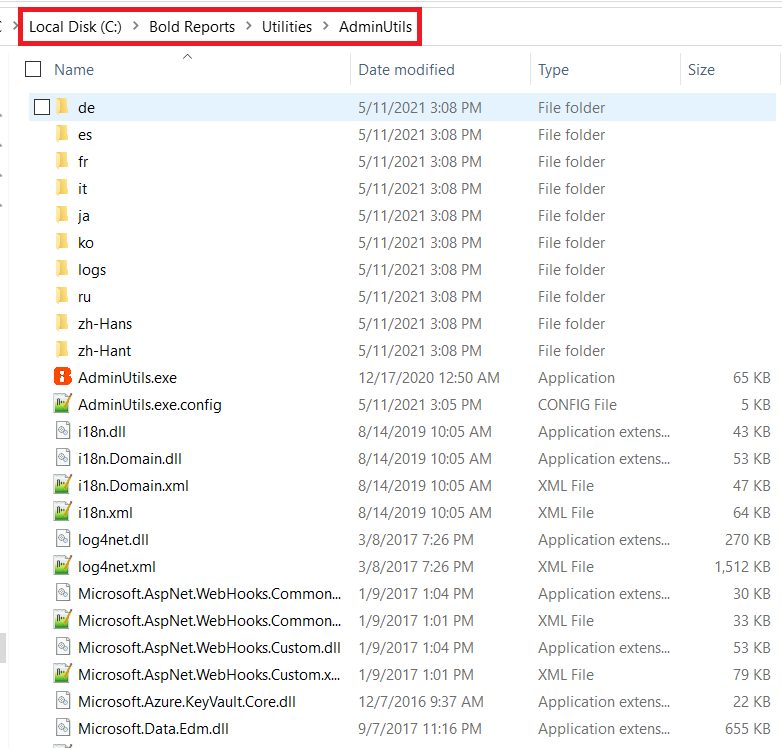
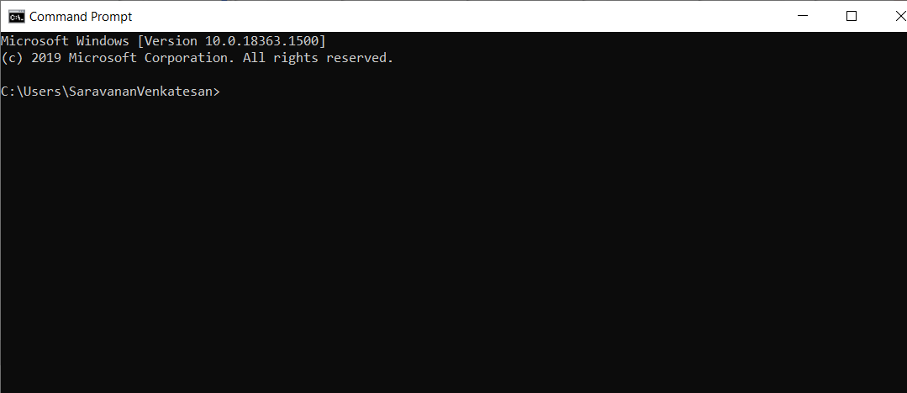
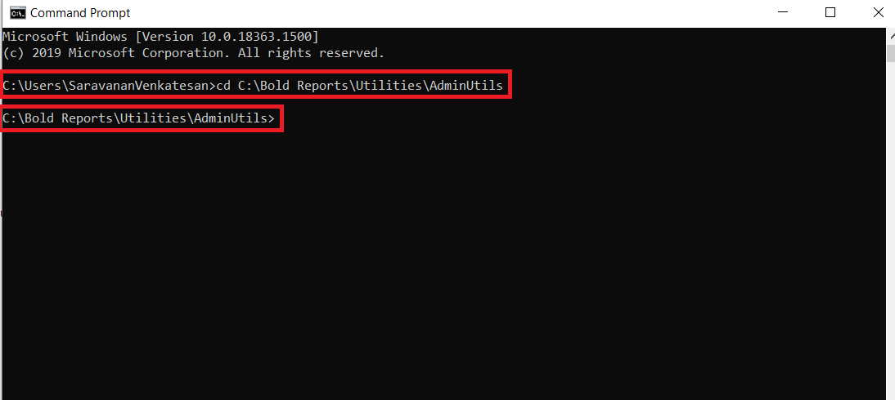

# Admin Utility for Bold Reports<sup>®</sup> version 2.4 or older

The Bold Reports<sup>®</sup> admin utility for version 2.4 or older is a command-line tool that you run from the `{Deployed Location}`\Utilities\AdminUtils folder.

## How do I use the admin utility in version 2.4 or older?

You run the Bold Reports<sup>®</sup> version 2.4 or older admin utility from a command prompt opened in the admin utility location.

* Switch the admin utility location to `{Deployed Location}`\Utilities\AdminUtils. The following screenshot shows the admin utility folder.

   

   > **NOTE:** By default, Bold Reports<sup>®</sup> will be deployed on `C:\Bold Reports`.

* Open the command prompt.

   

* Change the command prompt directory to the admin utility location with the following command:

   ```sh
   cd C:\Bold Reports\Utilities\AdminUtils
   ```

   

## Which commands are available in version 2.4 or older?

The Bold Reports<sup>®</sup> admin utility for version 2.4 or older supports the following commands:
* [**Reset Password**](./../v2.4-or-older/reset-password/)
* [**Update Application Database**](./../v2.4-or-older/reset-application-database/)

## See also

* [Admin Utility overview](./../)
* [Reset password for version 2.4 or older](./../v2.4-or-older/reset-password/)
