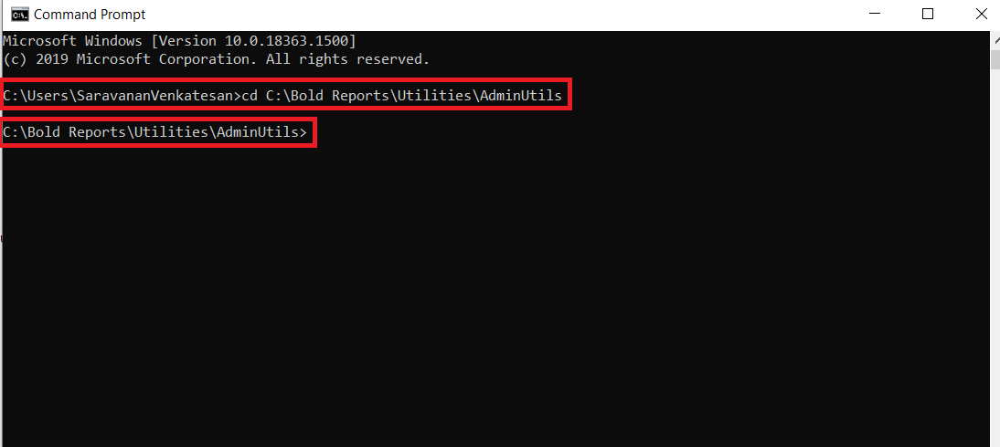
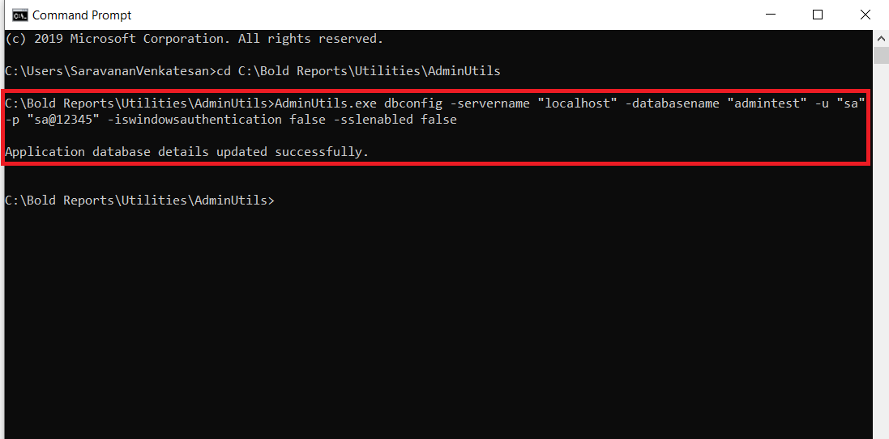

# Reset Application Database for Bold Reports<sup>®</sup> version 2.4 or older

You can reset the database of the Bold Reports<sup>®</sup> application in version 2.4 or older with the admin utility `dbconfig` command.

## How do I reset the application database in version 2.4 or older?

To reset the Bold Reports<sup>®</sup> version 2.4 or older application database, run `AdminUtils.exe dbconfig` and then restart the application in IIS. Follow these steps:

1. Open the command prompt and change the directory to the admin utility location.

   ```sh
   cd C:\Bold Reports\Utilities\AdminUtils
   ```

   The following screenshot shows the command prompt in the admin utility location.

   

2. Run the following command to reset the database:

   ```sh
   AdminUtils.exe dbconfig -servername "localhost" -databasename "BoldReportsMasterDatabase" -u "Admin" -p "Admin@12345" -iswindowsauthentication false -sslenabled false
   ```

   > **IMPORTANT:**  command details:  
servername – SQL server hostname/IP  
databasename – SQL database name  
u – SQL server username  
p – SQL server password  
port - port number of Server(Required PostgreSQL only)  
iswindowsauthentication – Is windows authentication required (this is optional)  
sslenabled – Is encrypted connection required (this is optional)

   

3. After the database updates successfully, restart the application in IIS.

## Frequently asked questions

### Which parameters are optional in the dbconfig command?

The `iswindowsauthentication` and `sslenabled` parameters are optional. The port number is required for PostgreSQL only.

## See also

* [Admin Utility for version 2.4 or older](./../../v2.4-or-older/)
* [Reset password for version 2.4 or older](./../../v2.4-or-older/reset-password/)
* [Admin Utility overview](./../../)
