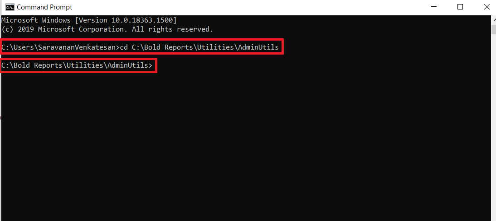
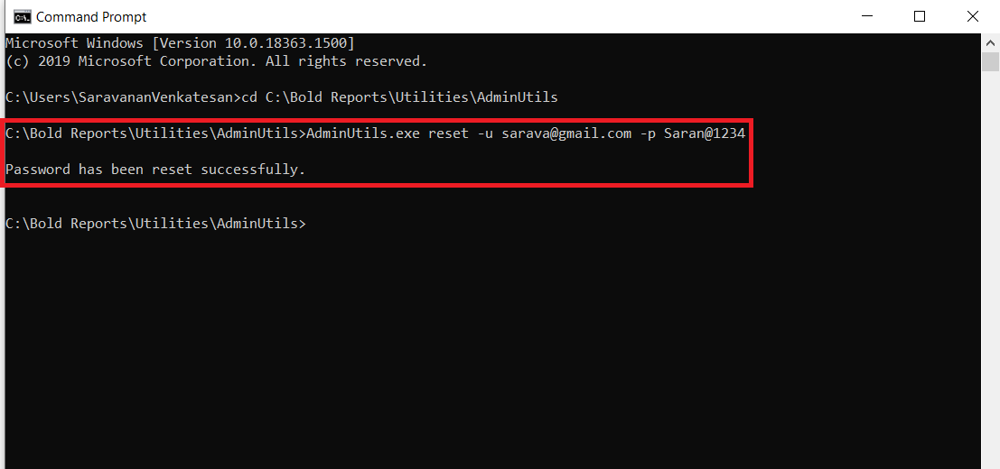

# Reset Password for Bold Reports<sup>®</sup> version 2.4 or older

You can reset the current password of any Bold Reports<sup>®</sup> user in version 2.4 or older with the admin utility, using their email address.

## How do I reset a user password in version 2.4 or older?

To reset a Bold Reports<sup>®</sup> version 2.4 or older user password, run the `AdminUtils.exe reset` command from the admin utility location. Follow these steps:

1. Open the command prompt and change the directory to the admin utility location.

   ```sh
   cd C:\Bold Reports\Utilities\AdminUtils
   ```

   The following screenshot shows the command prompt in the admin utility location.

   

2. Run the following command to reset the password:

   ```sh
   AdminUtils.exe reset -u 'user email here' -p 'new password here'
   ```

   

3. After the password resets successfully, the user can log in with the new password.

## See also

* [Admin Utility for version 2.4 or older](./../../v2.4-or-older/)
* [Reset application database for version 2.4 or older](./../../v2.4-or-older/reset-application-database/)
* [Admin Utility overview](./../../)
